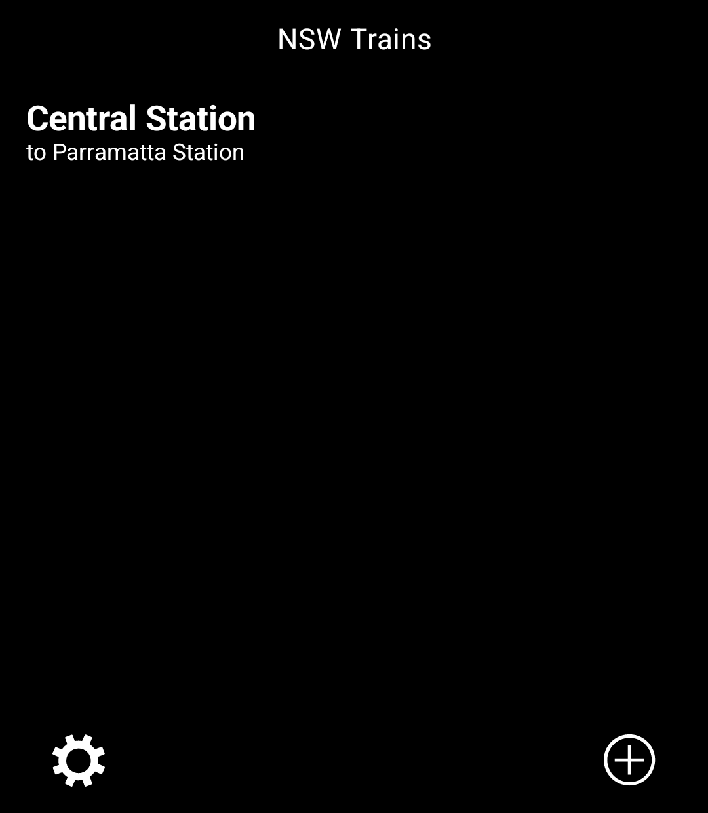
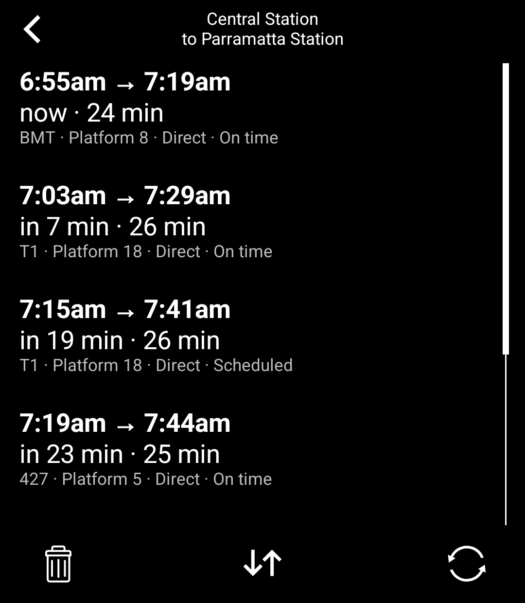
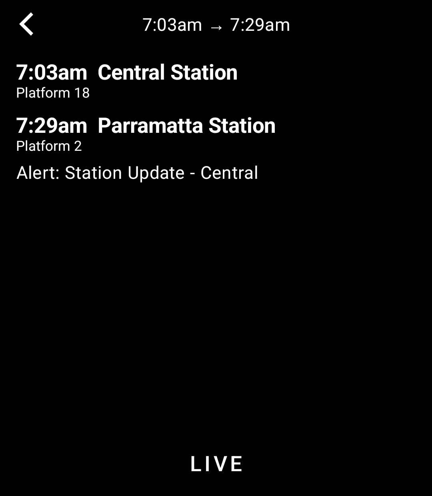
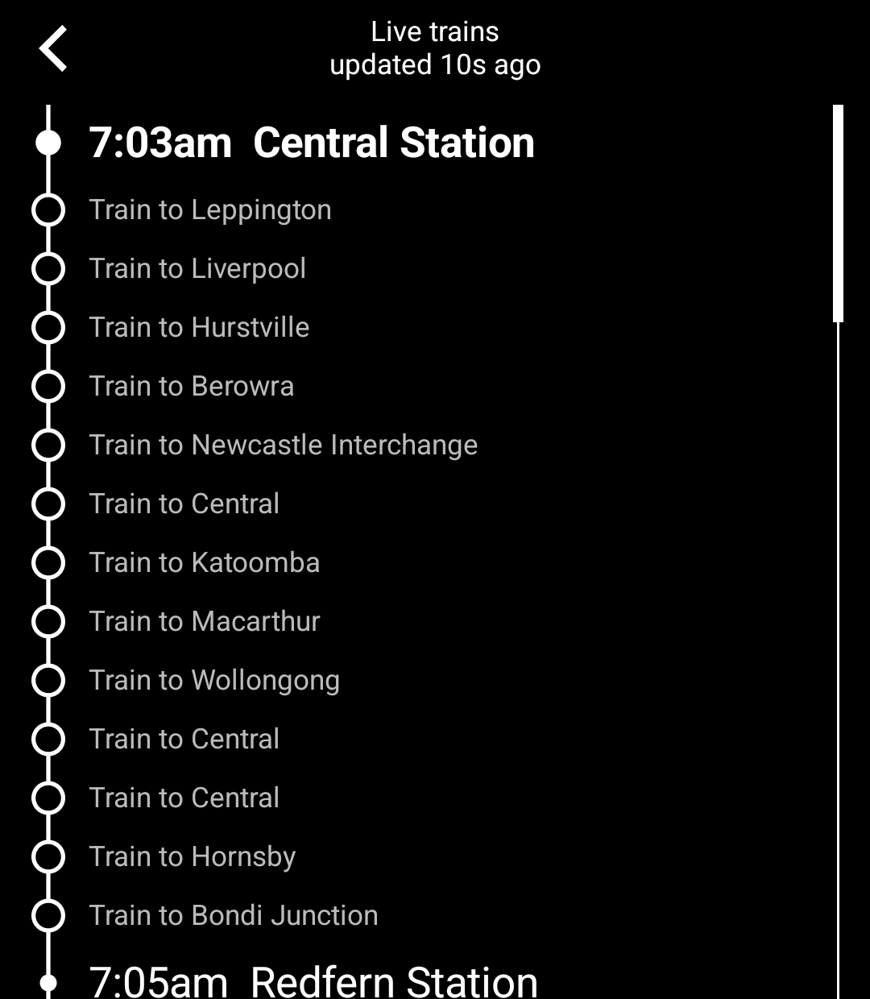

# NSW Trains for the Light Phone III

An unofficial train timetable tool for Sydney and NSW on the Light Phone III, built with the
[Light SDK](https://github.com/lightphone/light-sdk).

- Save the trips you take, like Central → Parramatta
- See the next departures with platform, line and whether they're on time
- Open a journey to see each leg and any service alerts
- Follow trains live along the line
- Flip a trip around with one tap

  
  
  
  

Covers Sydney Trains, Sydney Metro and NSW TrainLink, using the
[Transport for NSW Open Data](https://opendata.transport.nsw.gov.au) Trip Planner and realtime vehicle position
APIs. Timetable data © Transport for NSW, licensed under CC BY 4.0. This project is not affiliated with or
endorsed by Transport for NSW.

## Getting an API key

The tool needs your own free API key. It takes a few minutes, and the key stays on your phone.

1. Sign up at [opendata.transport.nsw.gov.au](https://opendata.transport.nsw.gov.au).
2. Create an application and add the **Trip Planner APIs** and the **Public Transport - Realtime Vehicle
   Positions** APIs to it.
3. Copy the application's API key.

The key is long, so you don't have to type it. On a computer, turn it into a QR code that contains only the key,
for example with `qrencode -t ansiutf8 'YOUR_KEY'` in a terminal. (Avoid online QR generators: they would see your
key.) Then in the tool open **Settings → Scan API key** and point the phone at the screen.

## Install

You need JDK 21, the Android SDK and `adb`, and a Light Phone III you can sideload tools onto over ADB.

1. In `tool/lighttool.toml`, switch `serverPackage` to `"com.lightos"` (the committed value targets the LightOS
   emulator).
2. Build: `./gradlew :tool:assembleDebug`
3. Install: `adb install -r tool/build/outputs/apk/debug/tool-debug.apk`

To run it in the LightOS emulator instead, keep the committed `serverPackage` and build with
`./gradlew :tool:assembleDebug -DlightSdk.allowAltServerPackage=true`.

The tool's code is in [`tool/`](../tool). Everything else in this repository is the Light SDK (MIT licence); the
SDK's own README is [`README.md`](../README.md).
