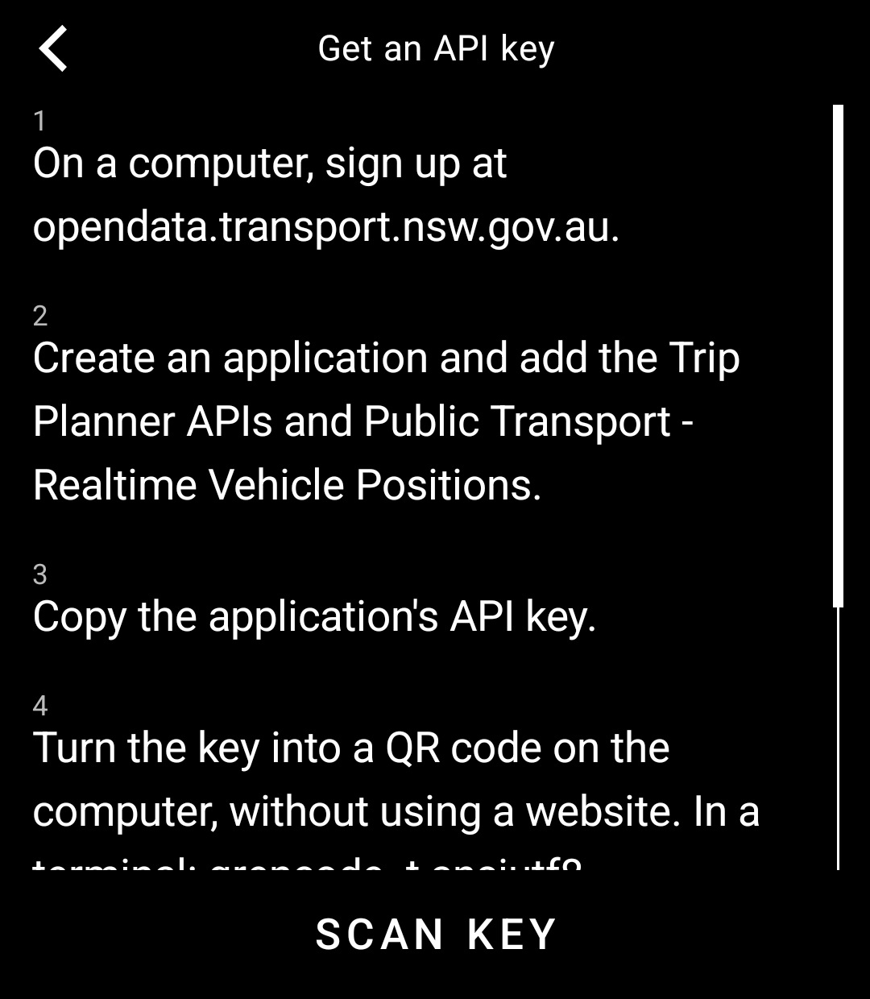

# NSW Trains for the Light Phone III

An unofficial train timetable tool for Sydney and NSW on the Light Phone III, built with the
[Light SDK](https://github.com/lightphone/light-sdk).

- Save the trips you take, like Central → Parramatta
- See the next departures with platform, line and whether they're on time
- Open a journey to see each leg and any service alerts
- Follow trains live along the line
- Flip a trip around with one tap

<p>
  
  
  
  
</p>

Covers Sydney Trains, Sydney Metro and NSW TrainLink, using the
[Transport for NSW Open Data](https://opendata.transport.nsw.gov.au) Trip Planner and realtime vehicle position
APIs. Timetable data © Transport for NSW, licensed under CC BY 4.0. This project is not affiliated with or
endorsed by Transport for NSW.

## Getting an API key

The tool needs your own free API key. It takes a few minutes, and the key stays on your phone. The same steps are
in the tool under **Settings → No key yet?**

1. Sign up at [opendata.transport.nsw.gov.au](https://opendata.transport.nsw.gov.au).
2. Create an application and add the **Trip Planner APIs** and the **Public Transport - Realtime Vehicle
   Positions** APIs to it.
3. Copy the application's API key.
4. Turn the key into a QR code on your computer (see below).
5. In the tool, open **Settings → Scan API key** and point the phone at the QR code on your screen.



### Turning the key into a QR code

The key is too long to type comfortably, so the tool scans it from a QR code. The QR code must contain only the
key. Make it on your own computer: an online QR generator would get a copy of your key.

**macOS** (with [Homebrew](https://brew.sh)) or **Linux**: install `qrencode`
(`brew install qrencode`, `sudo apt install qrencode` or `sudo dnf install qrencode`), then run

```sh
qrencode -t ansiutf8 'YOUR_KEY'
```

The QR code appears right in the terminal. If it's too big for the window, make the terminal font smaller.

**Windows, macOS or Linux with Python**: run

```sh
pip install qrcode
qr 'YOUR_KEY'
```

On Windows, use double quotes instead: `qr "YOUR_KEY"`.

You can also type the key in **Settings → Transport for NSW API key** if you prefer.

## Install

You need JDK 21, the Android SDK and `adb`, and a Light Phone III you can sideload tools onto over ADB.

1. In `tool/lighttool.toml`, switch `serverPackage` to `"com.lightos"` (the committed value targets the LightOS
   emulator).
2. Build: `./gradlew :tool:assembleDebug`
3. Install: `adb install -r tool/build/outputs/apk/debug/tool-debug.apk`

To run it in the LightOS emulator instead, keep the committed `serverPackage` and build with
`./gradlew :tool:assembleDebug -DlightSdk.allowAltServerPackage=true`.

The tool's code is in [`tool/`](../tool). Everything else in this repository is the Light SDK (MIT licence); the
SDK's own README is [`README.md`](../README.md).
